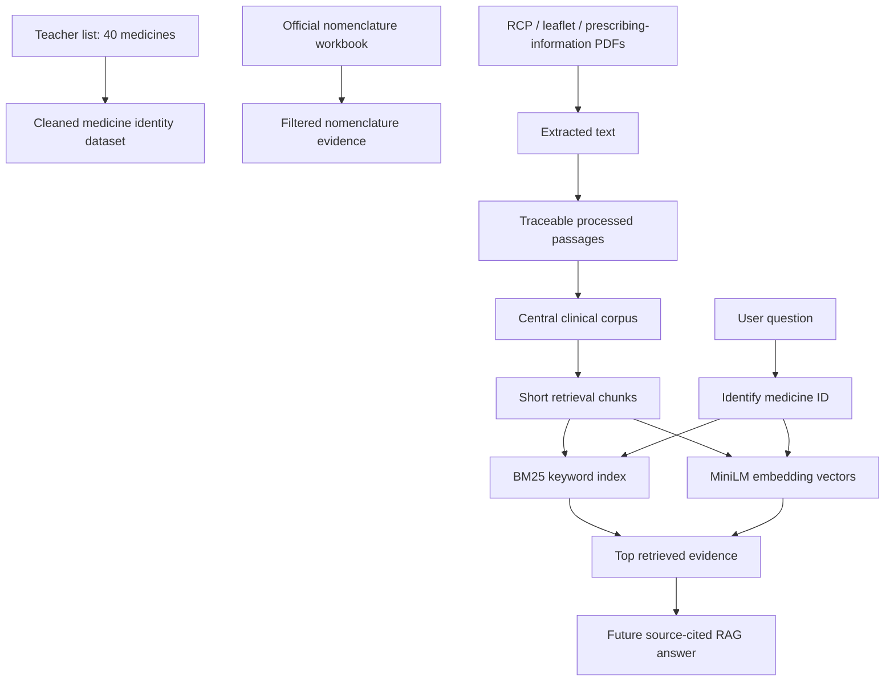

# Pharmeazor: onboarding, progress, and technical guide

> Audience: a teammate who has never seen this project or its code.
>
> Last checked: 25 November 2026.
>
> This is a living technical guide. It describes the current repository state;
> it is not a claim that every clinical sentence has been manually verified
> against every PDF.

## 1. The project in one minute

**Pharmeazor** is a source-grounded medicine-information project. Its initial
objective is to build a system that can find project-specific medicine evidence
before an LLM answers a question. The project must not treat an LLM's general
knowledge as evidence.

The teacher provided a fixed list of **40 medicines**. The project needs to:

1. recognize the medicine asked about;
2. find the correct official/product evidence when appropriate;
3. find clinical evidence in RCPs, leaflets, or prescribing information;
4. compare keyword and semantic retrieval fairly;
5. later give a source-cited answer, or say that evidence is insufficient.

The project is **not** a prescribing system. Nomenclature product strength is
not patient posology. Clinical claims must be supported by a retrieved clinical
source passage.

## 2. The big picture



There are two evidence layers:

| Layer                  | What it answers                                                                                  | Main source                                                              |
| ---------------------- | ------------------------------------------------------------------------------------------------ | ------------------------------------------------------------------------ |
| Identity/product layer | DCI, aliases, brand, pharmaceutical form, presentation strength, registration/availability facts | 40-medicine list + filtered official nomenclature                        |
| Clinical layer         | contraindications, precautions, adverse effects, interactions, age/pregnancy statements, etc.    | RCPs, leaflets, prescribing information, later ANSM interaction passages |

The layers must not be confused. A nomenclature row can support a fact such as
“this presentation is listed,” but not a clinical contraindication.

---

# 3. Repository map

```text
PROJET-RCR/
├── data/
│   ├── raw/                 original shared data; never edit
│   ├── reference/           teacher-provided 40-medicine list
│   ├── processed/           generated cleaned datasets and corpora
│   ├── review/              manual decisions and future review queues
│   ├── sources/             source registry / provenance data
│   └── indexes/             BM25 and vector-index artifacts
├── Pharmeazor/
│   └── documents/
│       └── <medicine>/
│           ├── raw/         original clinical PDFs
│           ├── extracted/   text extracted from those PDFs
│           └── processed/   standardized searchable passage JSON
├── scripts/                 reproducible project programs
├── results/                 experiment outputs only
├── docs/                    explanations, plans, and reports
└── README.md                short project entry point
```

The structure rule is simple:

```text
Every clinical document belongs in:
Pharmeazor/documents/<medicine>/raw|extracted|processed/
```

Do not create a second medicine corpus elsewhere. Folder capitalization from
older contributor work may still vary (`Raw`/`Extracted`/`Processed`), but new
work should use lowercase names. The processor accepts `Extracted` as well,
which protects existing contributor files on Windows.

For the detailed official structure rule, see
[PROJECT_STRUCTURE.md](PROJECT_STRUCTURE.md).

---

# 4. Week 1: mission, medicine identity, nomenclature, and baseline tests

## 4.1 Start with the fixed 40-medicine scope

The teacher-provided workbook is:

[Projet2_Liste_40_medicaments.xlsx](../data/reference/Projet2_Liste_40_medicaments.xlsx)

It was turned into a cleaned identity file:

[medicines_cleaned.json](../data/processed/medicines_cleaned.json)

Each medicine has a stable ID such as `M002`, a standardized DCI, aliases, and
other identity fields. Stable IDs are important because folder names, brands,
accents, and source languages vary. For example, `ibuprofène`, `ibuprofene`,
and a product brand should be linked to one medicine ID instead of treated as
different medicines.

## 4.2 What was done with the official nomenclature

The original nomenclature workbook was kept unchanged in `data/raw/`. The team
created a smaller working dataset containing only candidate rows relevant to
the 40 medicines.

```text
original nomenclature workbook
  -> search dictionary: DCI + raw names + aliases
  -> candidate rows for the 40 medicines
  -> accepted working records + separate ambiguous-review queue
```

Important files:

- [nomenclature working dataset](../data/processed/nomenclature_working.json)
- [manual review decisions](../data/review/nomenclature_manual_reviews.json)
- [ambiguous review queue](../data/review/nomenclature_review_queue.json)
- [build_nomenclature_working.py](../scripts/build_nomenclature_working.py)

This is the project’s first source reconciliation work. It does **not** mean
that every clinical conflict between RCPs has been reconciled; it means
nomenclature candidates were linked carefully to the standardized 40-medicine
scope and ambiguous cases were not silently trusted.

## 4.3 Baseline/API testing

The first experiments tested an LLM alone and then a metadata-based RAG
approach. The local `.env` file holds `GROQ_API_KEY`; it must never be
committed.

Relevant scripts:

- [llm_baseline.py](../scripts/llm_baseline.py): asks the model without
  retrieval evidence.
- [metadata_rag_experiment.py](../scripts/metadata_rag_experiment.py): gives
  the model retrieved 40-medicine identity evidence and, when selected,
  nomenclature evidence.
- [compare_rag_results.py](../scripts/compare_rag_results.py): readable
  comparison of metadata-only versus nomenclature-enriched runs.

The API/LLM was used for generation experiments, not to validate medical
facts. Rate limits or API errors are operational errors, not evidence that a
method performs well or badly.

## 4.4 What Week 1 showed

- Identity/product questions can often use the cleaned 40-medicine data and
  official nomenclature.
- Clinical questions cannot safely be answered from metadata alone.
- Refusals to answer clinical questions at this stage were a sign of missing
  clinical evidence, not a successful final result.

---

# 5. Week 2: clinical documents and processing

## 5.1 What the team collected

The team collected clinical documents across the 40-medicine scope, divided
among contributors. Sources include French RCPs and notices, and some official
foreign/US prescribing information where appropriate. The source type and
authority still need to be completed/verified in the source register for the
final report.

Each original clinical PDF should be preserved in the medicine’s `raw/`
folder. Never edit it. It is the evidence record that allows later review.

## 5.2 Extraction: PDF becomes text

Example location:

```text
Pharmeazor/documents/Ibuprofène/
  raw/IBUPROFENE ALMUS 400 mg, comprimé pelliculé RCP .pdf
  extracted/IBUPROFENE ALMUS 400 mg, comprimé pelliculé RCP .txt
```

The extraction script is:

[extract_rcp_text.py](../scripts/extract_rcp_text.py)

It reads a text-based PDF and writes an extracted `.txt` file. It also records
an extraction report. A scanned PDF that produces unusable text should be
listed in the future exclusion/problem register rather than silently used.

## 5.3 Processing: text becomes traceable evidence passages

The processor is:

[process_rcp_passages.py](../scripts/process_rcp_passages.py)

It does **not** create embeddings. It prepares source text so it can be cited
and searched later.

For each extracted text, it:

1. connects the text to the medicine ID using the folder/alias mapping;
2. connects the text to its same-stem raw PDF;
3. removes obvious webpage navigation/footer noise;
4. recognizes numbered RCP sections such as `4.4.` or `5.2.`;
5. splits long sections at sensible sentence/paragraph/list boundaries;
6. avoids heading-only passages where possible;
7. preserves PDF page metadata;
8. writes a standardized `*_passages.json` file;
9. rebuilds the central clinical corpus.

The standard passage schema includes fields such as:

```json
{
  "passage_id": "RCP-M002-...",
  "medicine_id": "M002",
  "standardized_dci": "ibuprofène",
  "source_pdf": "Pharmeazor/documents/.../raw/file.pdf",
  "source_text": "Pharmeazor/documents/.../extracted/file.txt",
  "section": "4.4. Mises en garde...",
  "page_start": 5,
  "page_end": 5,
  "text": "...",
  "verification_status": "extracted_not_manually_verified"
}
```

The final field is important. A processed passage is traceable and ready for
retrieval, but it is not a claim that a human has manually verified every
character against the PDF.

## 5.4 Current clinical-corpus status

At the time this guide was checked:

| Item                                         | Current count |
| -------------------------------------------- | ------------: |
| Medicines represented in the central corpus  |       40 / 40 |
| Traceable processed clinical passages        |         6,414 |
| Passage IDs unique                           |         6,414 |
| Passage records missing PDF links            |             0 |
| Passage records missing extracted-text links |             0 |

Central corpus:

[clinical_passages.jsonl](../data/processed/clinical_passages.jsonl)

Processing report:

[rcp_passage_processing_report.json](../data/processed/rcp_passage_processing_report.json)

---

# 6. Why a second chunking layer was needed

## 6.1 Evidence passages are not the ideal embedding size

The processed passages preserve source evidence. Some can still be too long
for the embedding model. The selected multilingual MiniLM model is configured
by SentenceTransformers to use at most **128 tokens**.

If a longer passage is embedded directly, the end can be ignored. This could
hide the exact renal warning, interaction, or age restriction being searched
for. That was a key teacher correction before Week 3.

## 6.2 Retrieval chunks solve this without destroying evidence

```text
processed source passage (evidence layer)
  -> one or more short retrieval chunks (search layer)
  -> BM25 and semantic/vector search
```

The original passage is never replaced. Every retrieval chunk retains a link
to its `parent_passage_id`, source PDF, section, and page range.

Builder script:

[build_retrieval_chunks.py](../scripts/build_retrieval_chunks.py)

Output files:

- [retrieval_chunks.jsonl](../data/processed/retrieval_chunks.jsonl)
- [retrieval chunk metadata](../data/processed/retrieval_chunks_metadata.json)

## 6.3 Current retrieval-chunk status

| Item                            | Current count |
| ------------------------------- | ------------: |
| Retrieval chunks                |        17,205 |
| Unique retrieval chunk IDs      |        17,205 |
| Maximum configured chunk length |    110 tokens |
| MiniLM model limit              |    128 tokens |
| Chunks above 110 tokens         |             0 |

The 110-token limit deliberately leaves room below MiniLM’s 128-token limit.
The chunk builder prefers paragraphs, complete sentences, and complete list
items, keeps headings with their explanation, and excludes heading-only search
chunks.

---

# 7. Two retrieval methods: BM25 versus embeddings

Both methods search the **same** 17,205 retrieval chunks. This makes the later
comparison fair.

## 7.1 BM25 = keyword retrieval

BM25 is not an embedding model. It is a mathematical keyword-ranking method.
It gives more weight to useful terms shared by a question and a chunk, while
reducing the impact of very common words.

```text
Question: "précautions ... insuffisance rénale ... ibuprofène"
     ↓
Normalize case, accents, punctuation, common stop words
     ↓
BM25 scores chunks containing useful matching terms
     ↓
Top 3 chunks, citations, and scores
```

Builder/query script:

[build_bm25_index.py](../scripts/build_bm25_index.py)

Saved artifacts:

- [BM25 index](../data/indexes/clinical_bm25_index.json)
- [BM25 index metadata](../data/indexes/clinical_bm25_index_metadata.json)

Current BM25 index state:

| Item                    |                         Value |
| ----------------------- | ----------------------------: |
| Indexed chunks          |                        17,205 |
| Unique normalized terms |                        18,448 |
| Algorithm               | BM25 (`k1=1.5`, `b=0.75`) |

Example query:

```powershell
py scripts\build_bm25_index.py --query "Quelles précautions prendre chez les patients présentant une insuffisance rénale lors de l'utilisation de l'ibuprofène ?" --medicine-id M002 --top-k 3
```

## 7.2 Semantic retrieval = embeddings/vectors

An embedding model converts text into a list of numbers called a **vector**.
Texts with similar meanings tend to have vectors close together, even if the
exact words differ.

```text
retrieval chunk text
  -> MiniLM model
  -> 384-number normalized vector

question text
  -> same MiniLM model
  -> 384-number normalized vector

dot product / cosine similarity
  -> rank chunks by meaning similarity
```

The model used is:

```text
sentence-transformers/paraphrase-multilingual-MiniLM-L12-v2
```

Builder/query script:

[build_semantic_index.py](../scripts/build_semantic_index.py)

Saved artifacts:

- [embedding matrix](../data/indexes/clinical_embeddings.npy)
- [embedding metadata](../data/indexes/clinical_embedding_metadata.jsonl)
- [embedding index metadata](../data/indexes/clinical_embedding_index_metadata.json)
- [embedding build progress](../data/indexes/clinical_embedding_progress.json)

Current semantic-index state:

| Item                  |       Value |
| --------------------- | ----------: |
| Build status          |    complete |
| Vectors               |      17,205 |
| Dimensions per vector |         384 |
| Data type             | `float32` |
| Input chunk limit     |  110 tokens |
| Model limit           |  128 tokens |

The index was saved so the project does not need to embed every chunk again for
each question.

Example semantic query:

```powershell
py scripts\build_semantic_index.py --query "Quelles précautions prendre chez les patients présentant une insuffisance rénale lors de l'utilisation de l'ibuprofène ?" --medicine-id M002 --top-k 3
```

## 7.3 Why the medicine filter matters

A global question about renal impairment may correctly match a renal warning
for celecoxib, ceftriaxone, or ibuprofen. If the user asked specifically about
ibuprofen, retrieving another medicine is not an acceptable final result.

The intended pipeline is:

```text
question -> identify medicine ID -> search only chunks for that medicine ID
```

For example, ibuprofen is `M002`, so use `--medicine-id M002`. Global search
is useful only for a deliberately multi-medicine question.

---

# 8. The Week 2 correction currently underway

The teacher accepted the corpus work but asked the team to correct retrieval
evaluation before drawing conclusions.

The detailed plan is here:

[CORRECTION_PLAN_BEFORE_WEEK3.md](CORRECTION_PLAN_BEFORE_WEEK3.md)

The important correction sequence is:

```text
1. Short, token-safe retrieval chunks              COMPLETE
2. Real BM25 keyword index                          COMPLETE
3. Persistent MiniLM vector/embedding index         COMPLETE
4. Rerun three ibuprofen renal questions             NEXT
5. Make >=15 manually labelled questions             NEXT
6. Compare BM25 and semantic top 3                  NEXT
7. Report Hit@3 and MRR@3                            NEXT
8. Finish source register / OCR exclusion list       NEXT
```

The old ibuprofen tests were removed because they used the earlier comparison
setup: not the new short retrieval chunks, not saved full-corpus embeddings,
and not a BM25 baseline. New tests must use the current BM25 and semantic
scripts on the common retrieval-chunk corpus.

## 8.1 What must happen next

### A. Build the evaluation questions

Create at least 15 questions across multiple medicines. For each question,
manually identify relevant `retrieval_chunk_id` values **before** viewing ranked
results. That prevents cherry-picking after the search has run.

Suggested future file:

```text
data/reference/retrieval_evaluation_questions.json
```

### B. Run both methods on every question

For each question, record:

- question ID and medicine ID;
- expected relevant retrieval-chunk ID(s);
- BM25 top 3 IDs, scores, and full evidence;
- semantic top 3 IDs, scores, and full evidence;
- whether an expected result appeared in top 3;
- rank of the first expected result;
- a short manual error note if it failed.

### C. Calculate evaluation metrics

- **Hit@3**: how often at least one relevant chunk appeared in the first three.
- **MRR@3**: how high the first relevant chunk appeared; rank 1 is better than
  rank 3, and no relevant top-3 result scores zero.

Do not claim that semantic search is better until those results exist.

---

# 9. File-type glossary

| File type    | What it is                 | Typical project use                                                    | Edit manually?                            |
| ------------ | -------------------------- | ---------------------------------------------------------------------- | ----------------------------------------- |
| `.pdf`     | Original source document   | RCPs, notices, prescribing information in `raw/`                     | No                                        |
| `.txt`     | Extracted plain text       | Input to passage processing                                            | Usually no; re-extract if wrong           |
| `.json`    | One structured object/file | medicine records, processed document passages, index metadata, reports | Source/review JSON yes; generated JSON no |
| `.jsonl`   | One JSON object per line   | large corpora/metadata rows that can be streamed efficiently           | Generated; do not edit manually           |
| `.npy`     | NumPy binary numeric array | saved embedding matrix/vectors                                         | No; regenerate with script                |
| `.xlsx`    | Excel workbook             | teacher medicine list, original nomenclature                           | Original/reference: no                    |
| `.md`      | Markdown documentation     | reports, guides, plans, readable evidence summaries                    | Yes                                       |
| `.py`      | Python program             | reproducible extraction, processing, retrieval, evaluation             | Yes, but understand/test changes          |
| `.gitkeep` | Empty placeholder          | preserves an otherwise empty directory in Git                          | Leave until real files replace it         |
| `.env`     | local environment secrets  | API key such as `GROQ_API_KEY`                                       | Never commit                              |

## 9.1 The difference between the most confusing files

```text
*_passages.json
  = source evidence passages from one document
  = readable text + pages + source metadata
  = NOT embeddings

clinical_passages.jsonl
  = all standardized evidence passages combined
  = NOT embeddings

retrieval_chunks.jsonl
  = shorter, token-safe searchable copies linked to evidence passages
  = NOT embeddings

clinical_embeddings.npy
  = actual numerical vectors created by MiniLM
  = embeddings

clinical_embedding_metadata.jsonl
  = tells us what each vector row means and where its evidence came from
```

---

# 10. How to run the important workflows

Run commands from the repository root:

```text
C:\Users\AL19TECH\Desktop\project\PROJET-RCR
```

## 10.1 Add a newly collected clinical PDF

```powershell
# 1. Put the unchanged PDF into the medicine's raw/ folder.
# 2. Extract its text.
py scripts\extract_rcp_text.py "Pharmeazor\documents\<medicine>\raw\<document>.pdf"

# 3. Process it into standardized source passages.
py scripts\process_rcp_passages.py "Pharmeazor\documents\<medicine>\extracted\<document>.txt"

# 4. Rebuild short retrieval chunks for the changed corpus.
py scripts\build_retrieval_chunks.py

# 5. Rebuild BM25 and semantic indexes because the chunk corpus changed.
py scripts\build_bm25_index.py --rebuild
py scripts\build_semantic_index.py --rebuild --batch-size 32
```

## 10.2 Check semantic-index build progress

```powershell
py scripts\build_semantic_index.py --status
```

If a build was interrupted after it started, resume it without `--rebuild`:

```powershell
py scripts\build_semantic_index.py --batch-size 32
```

## 10.3 Query one medicine with both retrieval methods

```powershell
# BM25 keyword retrieval
py scripts\build_bm25_index.py --query "<question>" --medicine-id M002 --top-k 3

# Semantic/vector retrieval
py scripts\build_semantic_index.py --query "<question>" --medicine-id M002 --top-k 3
```

Replace `M002` with the requested medicine’s stable ID. Use the cleaned
medicine dataset to find IDs:

[medicines_cleaned.json](../data/processed/medicines_cleaned.json)

---

# 11. What is complete, what is not

## Complete or structurally complete

- 40 medicines are represented in the standardized clinical corpus.
- Original clinical PDFs, extracted text, and standardized processed passages
  are linked in the central corpus.
- Token-safe retrieval chunks exist for the shared corpus.
- The BM25 index is built.
- The MiniLM vector/semantic index is built.
- The project has a reproducible script for each transformation.

## Still required before Week 3 conclusions

- A shared evaluation set of at least 15 questions over multiple medicines.
- Manually selected expected relevant retrieval chunks.
- BM25 and semantic top-3 results saved for each question.
- Hit@3 and MRR@3 for each method.
- Rerun of the three ibuprofen renal questions using the corrected pipeline.
- Source register completion: source name, authority, URL, access date,
  document count, collection method.
- List of failed/scanned/OCR-excluded PDFs, if any.
- Manual verification/reconciliation where source conflicts or extraction
  problems are discovered.

## Important limitation

The text `verification_status: extracted_not_manually_verified` remains correct
for the generated clinical passages. It prevents the team from overstating the
quality of the evidence. Retrieval can be evaluated now, but clinical claims
must still be manually checked against the cited source before being presented
as verified medical information.

---

# 12. Team handoff and safe Git practice

The specific Person 1 retrieval-chunk handoff is here:

[PERSON1_RETRIEVAL_CHUNKS_HANDOFF.md](PERSON1_RETRIEVAL_CHUNKS_HANDOFF.md)

Suggested role split:

| Role                    | Responsibility                                                             |
| ----------------------- | -------------------------------------------------------------------------- |
| Retrieval preparation   | rebuild passages/chunks when corpus changes; maintain IDs and traceability |
| BM25 owner              | maintain/query keyword index                                               |
| Semantic owner          | maintain/query vector index and progress checkpoints                       |
| Evaluation/source owner | 15-question labels, metrics, source register, OCR/problem list             |

Before merging a contributor branch into `main`:

1. run `git fetch origin`;
2. inspect `git diff --stat main..origin/<branch>`;
3. check that new documents use the standard `Pharmeazor/documents/<medicine>/`
   structure;
4. do not merge parallel duplicate corpus trees;
5. commit generated outputs only when they are reproducible and useful to the
   team.

---

# 13. Quick troubleshooting

| Symptom                                               | Likely cause                                              | Safe response                                                                       |
| ----------------------------------------------------- | --------------------------------------------------------- | ----------------------------------------------------------------------------------- |
| A newly added medicine is absent from retrieval       | passages/chunks/indexes were not rebuilt                  | process TXT, then rerun chunks, BM25, embeddings in that order                      |
| Semantic build is slow                                | CPU embedding of thousands of chunks                      | use `--status`; allow resume from checkpoint                                      |
| Semantic or BM25 retrieves another medicine           | no medicine filter / identity match                       | apply `--medicine-id` after identifying the medicine                              |
| PDF link is null in a passage                         | TXT/PDF stems do not match or raw file missing            | rename/match source carefully, then reprocess                                       |
| A generated passage looks wrong                       | extraction/OCR or chunking issue                          | inspect TXT and original PDF; fix source/process, then rebuild                      |
| A source conflicts with another source                | different country, formulation, date, or genuine conflict | preserve both sources; do not merge claims silently; add a review record            |
| Git shows `D` and `??` files after reorganization | renamed/moved files are not committed yet                 | review with `git status`, then stage intentional deletions and additions together |

---

# 14. Where to look first

If you only have five minutes, open these files in order:

1. [README.md](../README.md) — short project entry point.
2. [this guide](PROJECT_ONBOARDING_AND_PROGRESS_GUIDE.md) — full orientation.
3. [clinical passages](../data/processed/clinical_passages.jsonl) — central
   traceable clinical evidence.
4. [retrieval chunks](../data/processed/retrieval_chunks.jsonl) — common
   search corpus.
5. [BM25 metadata](../data/indexes/clinical_bm25_index_metadata.json) and
   [embedding metadata](../data/indexes/clinical_embedding_index_metadata.json)
   — current index state.
6. [correction plan](CORRECTION_PLAN_BEFORE_WEEK3.md) — remaining Week 3 work.

The guiding rule for every future change is:

> Preserve the original source, keep every transformation reproducible, retain
> traceability to the medicine/document/page, and evaluate retrieval before
> claiming that the answer system is reliable.
